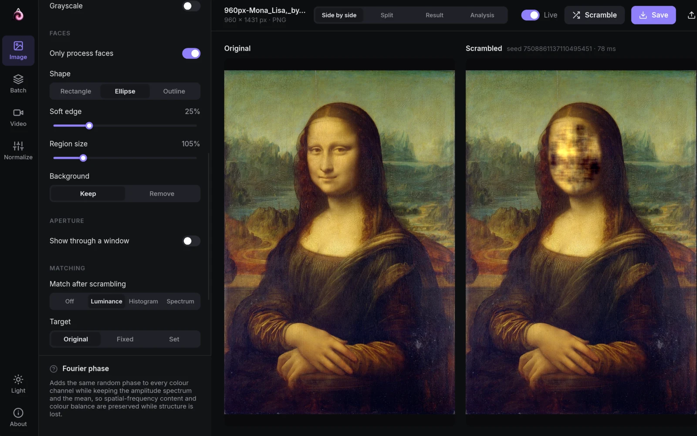
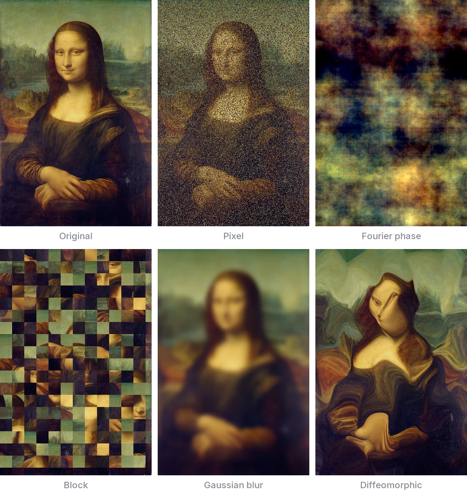
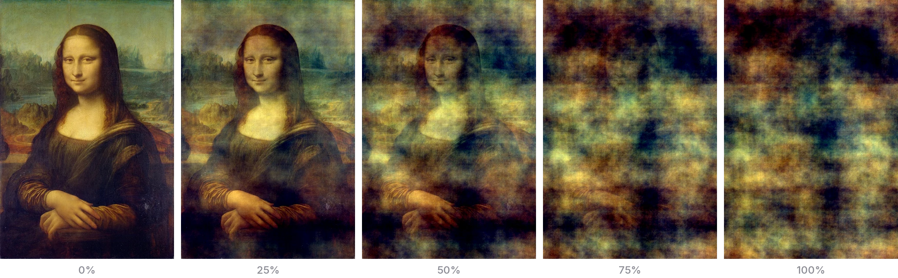
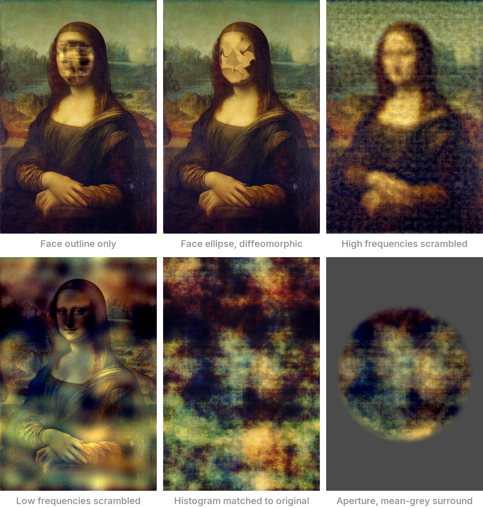
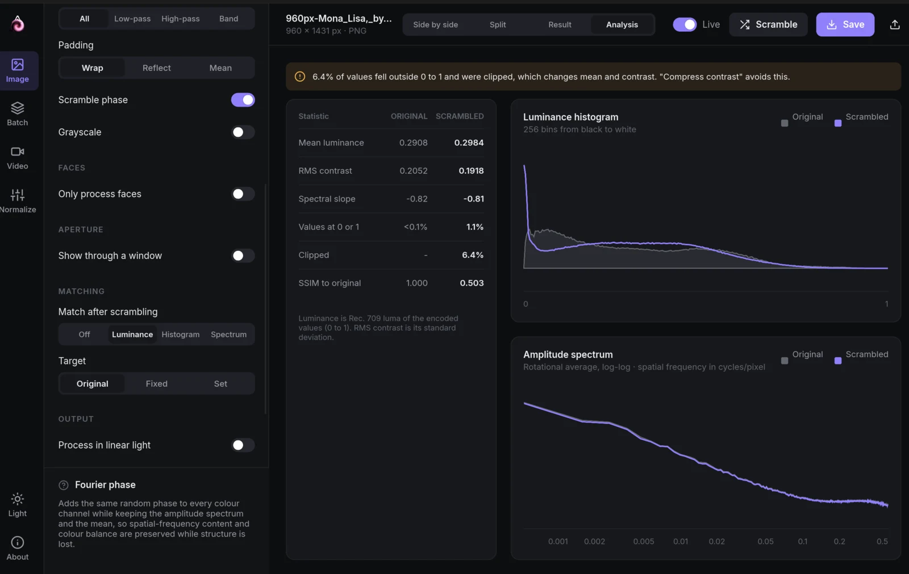
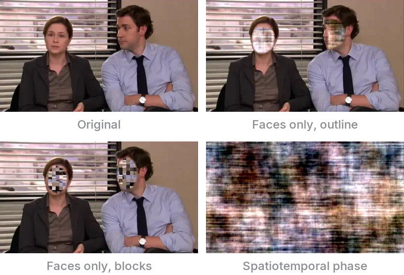
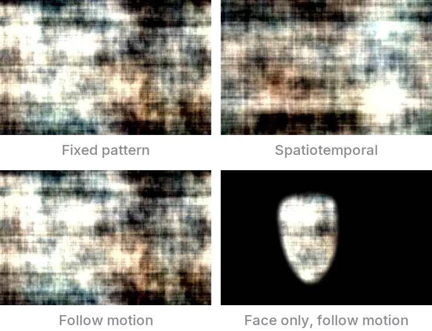

# Scramblery  
 

---

Scramblery is a tool designed to scramble images and videos for scientific, privacy, or artistic purposes. It offers various scrambling techniques, including pixel shuffling and frequency domain manipulation using Fourier transforms. 
This is a "byproduct" of my research for my master's [thesis](https://www.tandfonline.com/doi/full/10.1080/13506285.2024.2415721) [thesis2](https://papers.ssrn.com/sol3/papers.cfm?abstract_id=4341900) along with [butter2d](https://github.com/altunenes/butter2d) :-) 

---

  

---

## Features

- **Image Scrambling:** Pixel, Fourier phase, local phase, block, Gaussian blur and diffeomorphic scrambling (Stojanoski & Cusack, 2014). Local phase scrambling randomises phase within Gabor-like bands of scale and orientation, so contrast stays where it was in the image.
- **Spatial Frequency Control:** Scramble (or filter) a low-pass, high-pass or band-pass range given in cycles per pixel, cycles per image or cycles per degree.
- **Analysis:** Compare original and scrambled images: mean luminance, RMS contrast, histograms, rotationally averaged amplitude spectrum and its slope, clipping and SSIM.
- **Normalization:** Equate mean luminance and contrast, histograms or amplitude spectra across a set of images, using the methods of the SHINE toolbox (Willenbockel et al., 2010).
- **Matching:** Match each scrambled image to its original, to fixed values or to a set average, live in the preview and in batch and video processing.
- **Image Sets:** Batch processing of folders, several differently seeded scrambles per image, and intensity series that vary only the scrambling strength, e.g. for psychometric functions.
- **Faces and Apertures:** Restrict scrambling to detected faces (face outline from facial landmarks, ellipse or box, with soft edges), keeping or removing the background, and show stimuli through circular or elliptical windows on a uniform surround.
- **Reproducibility:** Every result records its seed; saved images get a JSON file with the exact settings, batch runs write a CSV report with statistics for each image, and settings can be saved and loaded as recipes.
- **Bit Depth and Linear Light:** 16-bit images are processed and saved at 16 bits, and processing can optionally run in linear light rather than on gamma encoded values.
- **Video Scrambling:** Frame by frame scrambling with a fixed or changing pattern, scrambling that follows the original motion (SEA-RAFT optical flow), and spatiotemporal phase scrambling that preserves spatial and temporal frequency content. Video is processed losslessly in its own colour space, at up to 10 bits, and in parallel.
- **Command Line:** `scramblery-cli` runs every method, the analysis and normalization from scripts. See [BUILD.md](BUILD.md).

How each method and statistic is defined is described in [docs/methods.md](docs/methods.md).

## Examples

  

An intensity series made with one seed: Fourier phase scrambling at 0% to 100%. Mean colour and the amplitude spectrum are kept at every level, apart from the few values clipped to the displayable range.

  

Beyond scrambling the whole image: faces only with soft outlines, a chosen spatial frequency band, matching to the original, and apertures.

  

Every result can be checked in the Analysis view: luminance, contrast, spectral slope, clipping and SSIM against the original, with histograms and amplitude spectra.

  

### Video

Faces are detected in every frame; spatiotemporal scrambling randomises the phase across space and time together.

  

Temporal modes on a fast head movement, phase scrambled at 100%. *Fixed pattern* applies one scramble to every frame; *Spatiotemporal* scrambles space and time together, keeping spatial and temporal frequency content; *Follow motion* uses optical flow (SEA-RAFT) to move the scramble with the content, so the motion of the original is kept while its form is not. Combined with face detection (here with the background removed), only the face is scrambled and the scramble moves with it.

  

---

## Installation

For installation instructions, please refer to the [INSTALLATION GUIDE](https://github.com/altunenes/scramblery/blob/main/INSTALL.md).

---

## Acknowledgements

Scramblery uses the following methods. If you use these features in your research, please cite the original authors also:

**Diffeomorphic Scrambling:**

> Stojanoski, B., & Cusack, R. (2014). Time to wave good-bye to phase scrambling: Creating controlled scrambled images using diffeomorphic transformations. *Journal of Vision*, 14(12):6, 1–16. doi:[10.1167/14.12.6](https://doi.org/10.1167/14.12.6)

**Normalization:**

> Willenbockel, V., Sadr, J., Fiset, D., Horne, G. O., Gosselin, F., & Tanaka, J. W. (2010). Controlling low-level image properties: The SHINE toolbox. *Behavior Research Methods*, 42(3), 671–684. doi:[10.3758/BRM.42.3.671](https://doi.org/10.3758/BRM.42.3.671)

**SEA-RAFT Optical Flow (Follow motion):**

> Wang, Y., Lipson, L., & Deng, J. (2024). SEA-RAFT: Simple, Efficient, Accurate RAFT for Optical Flow. *European Conference on Computer Vision (ECCV)*. Princeton Vision & Learning Lab.

---

## Citation

Please cite Scramblery with the DOI that covers all versions, and mention the version you used (shown in the app and in the JSON settings saved with each result):

> Altun, E. Scramblery (Version x.y.z) [Computer software]. Zenodo. https://doi.org/10.5281/zenodo.7484576
